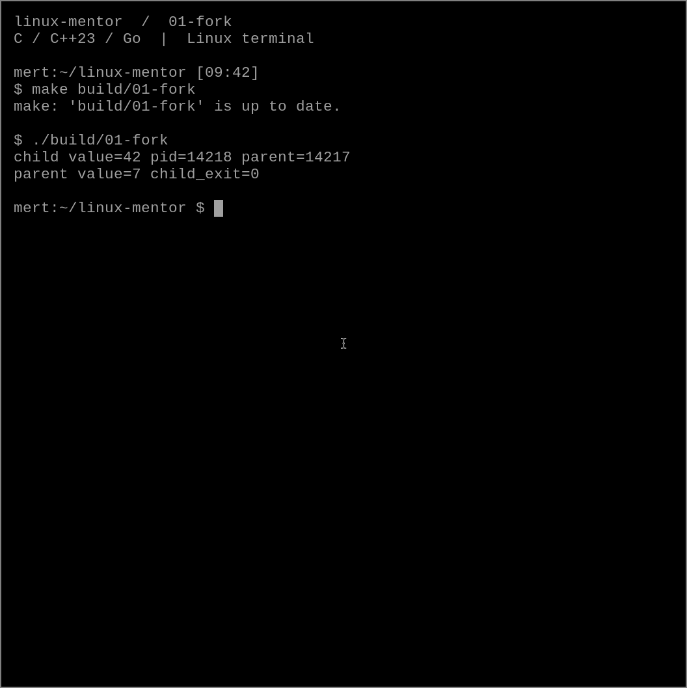

# 01 — fork sonrası değişken kimin?

Bir süreçte `value = 7` olsun. `fork()` sonrasında çocuk bunu 42 yaparsa ebeveyn ne görür?
Çalıştırmadan önce tahmin et: 7 mi, 42 mi?

## Dene

Repo kökünde:

```sh
make build/01-fork
./build/01-fork
```

```text
child value=42 pid=... parent=...
parent value=7 child_exit=0
```



## Ne oldu?

`fork()` tek çağrıdan iki yürütme akışı çıkarır: çocukta dönüş değeri sıfır,
ebeveynde çocuğun PID'sidir. Hata durumunda -1 döner; onu da kontrol ediyoruz.
Çocuk ve ebeveyn ayrı adres uzaylarına sahip olduğu için çocuğun normal değişkene
yazması ebeveynin değişkenini değiştirmez.

Ebeveyn `waitpid()` ile çocuğun bitmesini bekler. Bu hem çocuğun çıkış durumunu
toplar hem de bu örnekte çıktı sırasını belirler. `waitpid()` olmasaydı zamanlayıcı
hangi sürecin önce yazacağını belirlerdi. Beklenmeyen bitmiş çocuk bir süre zombie kalabilir.

`fork()` öncesindeki `fflush()` da boşuna değil: stdio'nun kullanıcı alanındaki
tamponu kopyalanır. Tamponda yazılmamış metin varsa iki süreç aynı metni basabilir.
Çocukta `_exit()` kullandığımız için kendi çıktısını ayrıca flush ediyoruz.

## Bu deney neyi kanıtlamaz?

Çıktı, bütün fiziksel belleğin hemen kopyalandığını göstermez. Linux olağan özel
sayfalarda copy-on-write kullanır. Bu deney yalnızca ayrı değişken değerlerini gözler;
sayfa kopyalama maliyetini ölçmez. Paylaşımlı eşlemeler ayrı bir konudur.

## Bir değişiklik yap

Çocukta değeri 100 yap, ebeveyndeki sonucu tahmin et. Sonra ebeveynin `printf()`
satırını `waitpid()` öncesine taşı ve birkaç kez çalıştır. Değer ile sıra aynı mesele mi?

Kontrol: `bash chapters/01-fork/check.sh` (önce derle).

Kaynaklar: [fork(2)](https://man7.org/linux/man-pages/man2/fork.2.html),
[waitpid(2)](https://man7.org/linux/man-pages/man2/waitpid.2.html).
