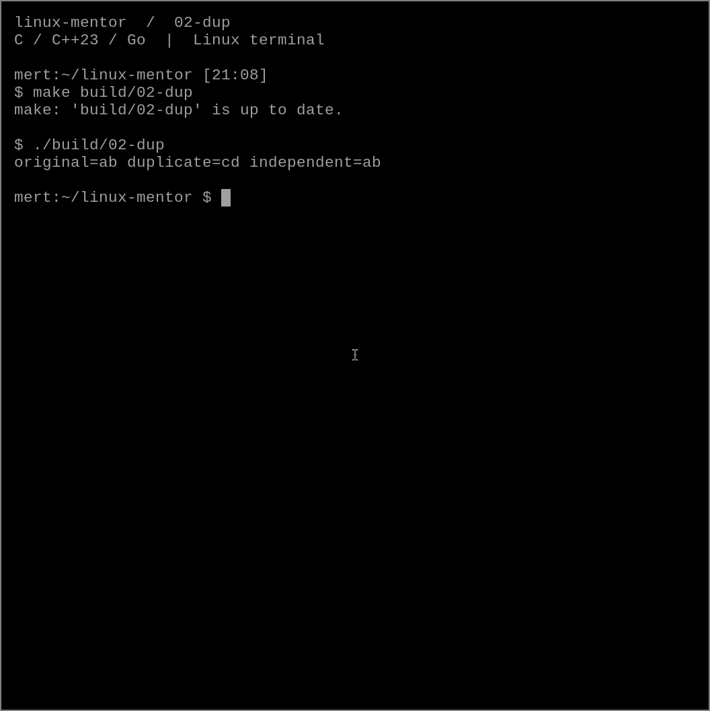

# 02 — dup dosyayı mı, descriptor'ı mı kopyalar?

Aynı dosyadan iki descriptor ile okuma yaptığında ikisi de baştan mı başlar?
Cevap, ikinci descriptor'ı nasıl aldığımıza bağlı.

## Dene

```sh
make build/02-dup
./build/02-dup
```

```text
original=ab duplicate=cd independent=ab
```



Program rastgele adlı bir geçici dosyaya `abcdef` yazar. Bir descriptor'ı `dup()`
ile çoğaltır, diğerini ayrı bir `open()` çağrısıyla açar. Sonra her birinden iki bayt okur.

## Ne oldu?

Descriptor, süreç içindeki küçük bir tamsayıdır. Çekirdekteki *open file description*
nesnesine başvurur. Okuma konumu, yani offset, bu nesnede tutulur.

`dup()` yeni bir descriptor üretir ama aynı açık dosya nesnesine başvurur.
İlk okuma konumu iki ilerlettiği için kopya descriptor `cd` okur.
Ayrı `open()` çağrısı ise ayrı bir açık dosya nesnesi oluşturur; onun konumu sıfırdır.
İki çağrının aynı disk dosyasına gitmesi, okuma konumlarını paylaşacakları anlamına gelmez.

Dosyayı açtıktan sonra adını `unlink()` ile kaldırıyoruz. Descriptor'lar açık olduğu
sürece dosya kullanılabilir. Son descriptor kapanınca bu geçici dosyanın kaynağı bırakılır.

## Sınır

Bu kısa örnek normal bir geçici dosyada iki baytlık okumaları kontrol eder.
Genel amaçlı I/O kodunda kısa okuma, EOF ve `EINTR` ayrı ele alınır.
`dup()` descriptor bayraklarının tamamını kopyalamaz; örneğin `FD_CLOEXEC` ortak değildir.

## Bir değişiklik yap

İkinci okumadan önce `lseek(copy, 0, SEEK_SET)` ekle. Sonra ilk descriptor'dan tekrar oku.
Konumu değiştiren descriptor farklı olsa bile sonuç neden değişiyor?

Kontrol: `bash chapters/02-dup/check.sh`.

Kaynaklar: [dup(2)](https://man7.org/linux/man-pages/man2/dup.2.html),
[open(2)](https://man7.org/linux/man-pages/man2/open.2.html).
