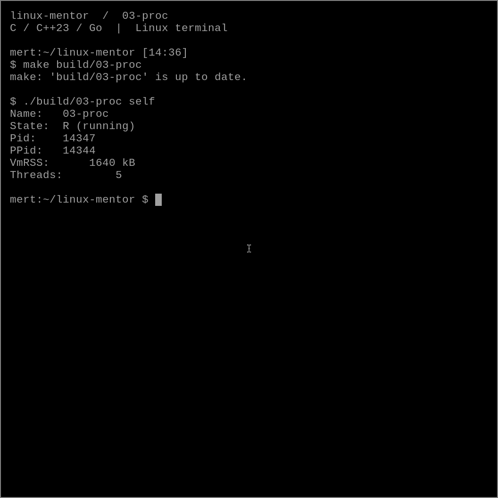

# 03 — /proc bize süreç hakkında ne söyler?

`ps` çıktısını kullanıyoruz; peki çekirdeğin sunduğu veriyi doğrudan okuyabilir miyiz?
Bu bölümde yalnızca Go standart kütüphanesiyle küçük bir süreç gözlemcisi var.

## Dene

```sh
make build/03-proc
./build/03-proc self
./build/03-proc $$
```

İlk komut programın kendisini, ikincisi mevcut shell sürecini inceler.
`Name`, `State`, `Pid`, `PPid`, `VmRSS` ve `Threads` alanlarını görürsün.



## Ne oldu?

`/proc` normal bir belge klasörü değildir. Çekirdek burada süreçlere ve sisteme ait
bilgileri dosya arayüzü üzerinden sunar. `/proc/self` dosyayı açan sürece işaret eder;
shell'de `cat /proc/self/status` çalıştırmak shell'i değil `cat` sürecini gösterir.

Program `/proc/<pid>/status` dosyasını açıp ilgilendiği satırları seçer.
PID argümanını pozitif tamsayı olarak doğrularız; gelen metni doğrudan yolun içine
eklemek istemiyoruz. Açılan dosya `defer` ile kapanır, tarama hatası da kontrol edilir.

Go programında birden fazla thread görmek normaldir. Goroutine ile işletim sistemi
thread'i bire bir değildir. `Threads` değeri goroutine sayacı olarak kullanılamaz.
`VmRSS` de toplam ayrılan sanal bellek değildir; yerleşik bellek hakkında bir göstergedir.

## Sınır

Bu çıktı anlık gözlemdir. Okuma sırasında süreç bitebilir; başka kullanıcının sürecine
erişim mount ve izin ayarları nedeniyle engellenebilir. `status` alanlarının varlığı
süreç türüne göre değişebilir. Bir izleme aracında eksik alanları sıfır sanmamak gerekir.

## Bir değişiklik yap

`VmSize` alanını da ekle ve `VmRSS` ile karşılaştır. Ardından `sleep 30 &` çalıştır,
verilen PID'yi incele ve süreç bittikten sonra aynı komutu tekrar dene.

Kontrol: `bash chapters/03-proc/check.sh`; geçersiz PID kontrolleri bilerek hata mesajı üretir.

Kaynaklar: [proc_pid_status(5)](https://man7.org/linux/man-pages/man5/proc_pid_status.5.html),
[Go os](https://pkg.go.dev/os).
